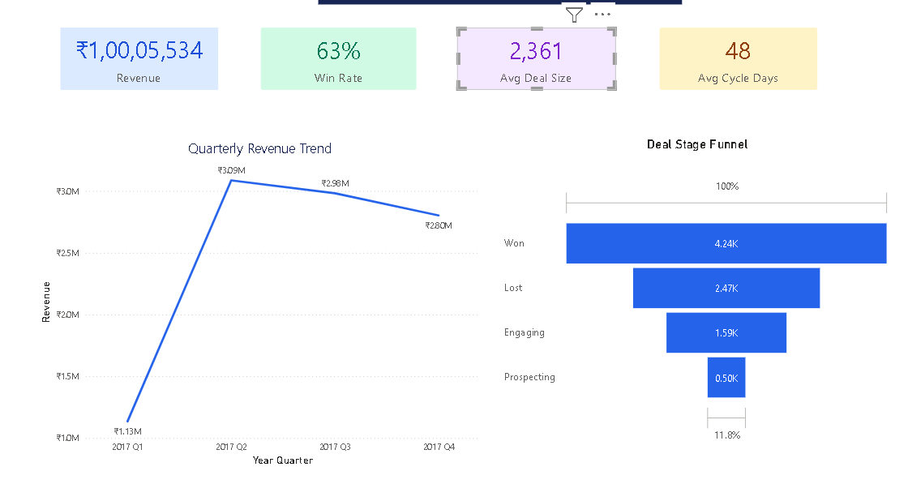
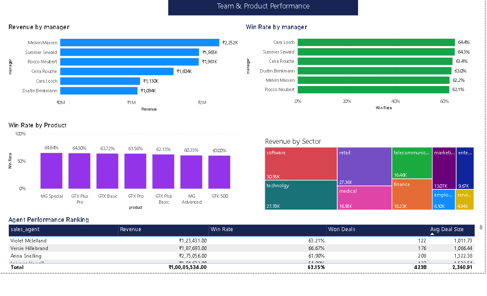

# 📊 MavenTech CRM Sales Performance Dashboard

An interactive Power BI dashboard for analyzing CRM sales performance, monitoring key performance indicators (KPIs), and comparing team and product performance.

## 🎯 Project Objectives

- Monitor overall sales performance.
- Track revenue, win rate, average deal size, and sales-cycle duration.
- Analyze quarterly revenue trends.
- Explore deal-stage distribution.
- Compare manager, agent, product, and sector performance.
- Support data-driven sales decisions.

## 🛠️ Tools & Technologies

- Microsoft Power BI
- DAX, where used for measures
- Power Query, where used for data preparation
- Data Visualization
- Business Intelligence
- KPI Reporting

## 📈 Key Performance Indicators

| KPI | Value Displayed |
|---|---:|
| Total Revenue | ₹1,00,05,534 |
| Win Rate | 63% |
| Average Deal Size | 2,361 |
| Average Cycle Days | 48 |

*These values are transcribed from the dashboard display and have not been independently audited.*

## 🖼️ Dashboard Preview

### 1. CRM Overview

The overview page presents the main sales KPIs, quarterly revenue trends, and deal-stage funnel.

### 2. Team & Product Performance

The second page compares manager performance, product win rates, sector revenue, and agent rankings.

## 🔍 Business Questions Explored

- How does revenue change across quarters?
- What is the overall sales win rate?
- What are the average deal size and sales-cycle duration?
- How does performance vary across managers and agents?
- How do win rates differ by product?
- Which customer sectors contribute to revenue?

## 💡 Key Observations

- The dashboard displays total revenue of ₹1,00,05,534 and a win rate of 63%.
- Q2 has the highest quarterly revenue in the displayed trend.
- The second dashboard page supports comparisons across managers, products, sectors, and agents.

These observations describe the displayed dashboard and are not independently validated business conclusions.

## 🧠 Skills Demonstrated

- Power BI dashboard development
- KPI monitoring and reporting
- Sales trend analysis
- Business data visualization
- Comparative performance analysis
- Business-question-driven reporting

## 📁 Project Files

| File | Description |
|---|---|
| `MavenTech-CRM.pbix` | Power BI report file |
| `page1-overview.png` | CRM overview screenshot |
| `page2-team-product.png` | Team and product performance screenshot |

## ⚠️ Dataset Availability

The original source dataset is not currently included in this repository. The dashboard is available for review, but full data-level reproducibility cannot be guaranteed.

## 👤 Author

**Awan Mansuri**  
MSc IT | Aspiring Data Analyst  
Ahmedabad, Gujarat, India

- GitHub: [awan-mansuri](https://github.com/awan-mansuri)
- LinkedIn: [Connect with me](https://www.linkedin.com/in/awan-mansuri)

